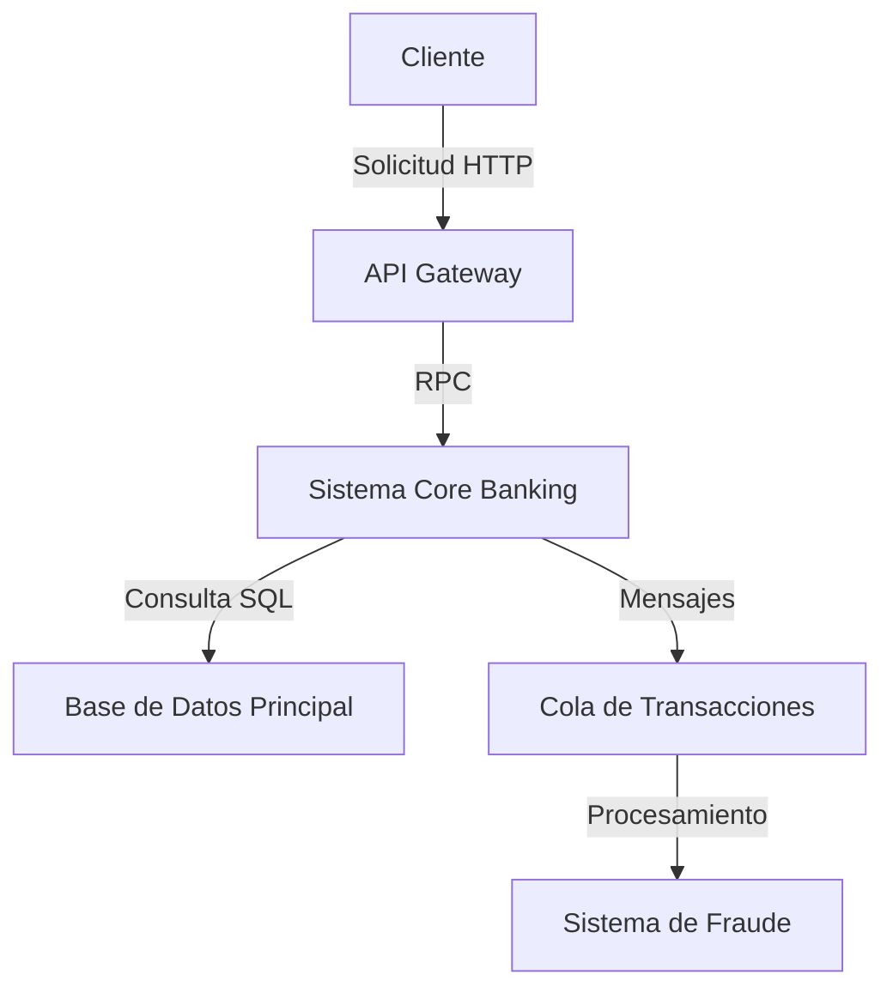
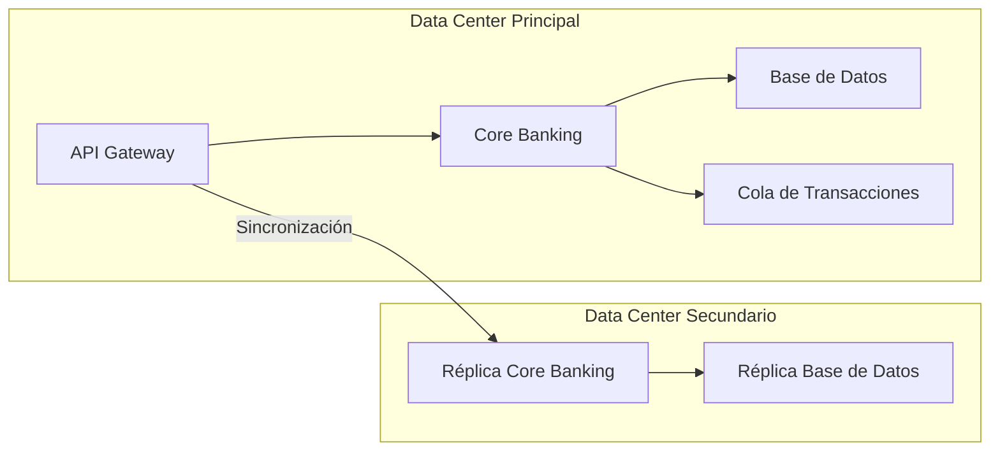

# Prompt para Mejorar el Codigo Base

Copia y pega el contenido del bloque de abajo en un asistente de IA (Claude, ChatGPT)
para obtener un ZIP con el proyecto completo y arrancable.

Si preferis trabajar en tu editor con un agente local (Claude Code, Cursor, Copilot), usa `AGENTS.md` en vez de este archivo: dice lo mismo pero para que escriba los archivos en disco.

## Las dos reglas que no se negocian

1. **Completa el boilerplate.** Todo lo que el proyecto necesita para compilar y arrancar: manifiesto de dependencias, punto de entrada, configuracion, capa de interfaz, y las capas del patron arquitectonico declarado. Eso es andamiaje y es tu trabajo.
2. **NO resuelvas el reto.** Los entregables de las fases son el trabajo de la persona. El hueco pedagogico se deja como esta: el proyecto arranca, pero lo que el reto pide implementar NO esta implementado.

Dicho de otra forma: si algo impide compilar, arreglalo. Si algo es logica de negocio incompleta, validaciones ausentes, un secreto hardcodeado o un patron mejorable, dejalo exactamente como esta — es lo que la persona tiene que encontrar.

## Superficie de practica — NO resuelvas

Estos archivos SON el ejercicio de la persona. No los implementes; deja stubs.

- `adr/001-transformacion-digital.md` — El topic pide decisiones de arquitectura: el ADR es el ejercicio.
- `adr/002-inversion-tecnologica.md` — El topic pide decisiones de arquitectura: el ADR es el ejercicio.

## Como saber que terminaste

```bash
python3 -c "import glob,sys; assert glob.glob('adr/*.md') and glob.glob('diagramas/*.mmd'), 'faltan ADRs o diagramas'"
```

Ese comando corriendo sin errores es la definicion de "listo".

---

```
## Briefing del reto (autoridad)
Este bloque manda sobre los archivos adjuntos. El stack y el rol salen de AQUÍ, no de un topic genérico ni de markdown placeholder.

### Perfil
Chapter Arquitectura, Especialidad Soluciones, Master

### Brecha de conocimiento
Realiza procesos de consultoría de arquitectura: Ha usado Frameworks para el entendimiento de Negocio como descubrimiento bottom up, front to back, back to front, top-down, Business Canvas Model, Deloitte Enterprise Value.

### Misión / candidato
Profesional senior con experiencia en consultoría y diseño de soluciones empresariales

### Reto
- Tema: Arquitectura con enfoque empresarial y frameworks estratégicos
- Seniority: master-l1
- Tipo: practical
- Título: Consultoría de Arquitectura para Transformación Digital
- Tiempo estimado: 180 minutos

### Fases (trabajo del HUMANO — PROHIBIDO completarlas)
No implementes estos entregables. Dejalos como hueco pedagógico. El asistente solo materializa el proyecto arrancable para que el participante pueda trabajar.
- Fase 1: Análisis del Negocio y Entendimiento del Entorno — objetivo: Identificar las necesidades del negocio y el entorno actual de la corporación. — entregable (NO resolver): Diagrama del Business Model Canvas y documento de capacidades técnicas actuales.
- Fase 2: Definición del Mapa de Capacidades Técnicas — objetivo: Definir el mapa de capacidades técnicas que la corporación necesita para su transformación digital. — entregable (NO resolver): Mapa de capacidades técnicas y documento de tecnologías y frameworks necesarios.
- Fase 3: Plan de Inversión y ROI — objetivo: Definir el plan de inversión que demuestre el ROI a largo plazo de la transformación digital. — entregable (NO resolver): Plan de inversión detallado y cálculo del ROI a largo plazo.
- Fase 4: Presentación y Validación del Plan — objetivo: Presentar y validar el plan de transformación digital ante los stakeholders. — entregable (NO resolver): Presentación detallada del plan de transformación digital y documento de comentarios y sugerencias de los stakeholders.

Eres un asistente experto en análisis, corrección y generación de archivos de cualquier tipo:
código fuente, documentación, hojas de cálculo, documentos Word, configuraciones, entre otros.
Voy a enviarte una cadena de texto que contiene uno o más archivos. Cada archivo está delimitado por un marcador con el siguiente formato:
// === ARCHIVO: ruta/del/archivo.extension ===
o también puede aparecer como:
## === ARCHIVO: ruta/del/archivo.extension ===
Lo que sigue al marcador puede ser:

El contenido real del archivo (código, texto, YAML, etc.)
Una descripción en lenguaje natural de lo que debe contener el archivo


TU TAREA
PASO 0 — ¿Esto es un proyecto o una carcasa?
Antes de extraer archivos, leé el Briefing (si está) y diagnosticá el adjunto.

Es CARCASA si ocurre CUALQUIERA de estas:
- No hay manifiesto de dependencias del stack del briefing (manifest.json de VTEX IO / package.json / pom.xml / build.gradle / requirements.txt / go.mod / *.tf / *.csproj, según corresponda)
- Hay un "binario" que en realidad es un comentario ("no puede ser mostrado como texto plano", placeholder .fig/.docx vacío)
- Los markdowns ya completan entregables de fases posteriores ("se implementó fade-in", lista de áreas ya resuelta)

Si es CARCASA:
- MATERIALIZÁ un proyecto que arranca en el stack del briefing (VTEX IO Store Framework, Angular, Terraform, pytest, Nest, etc.). Incluí manifiesto, punto de entrada y capa de interfaz reales.
- NO copies los markdowns de "solución" como si fueran el producto. Son ruido de generación.
- NO resuelvas las fases del briefing (están marcadas PROHIBIDO). Dejá el hueco pedagógico: el flujo existe, las microinteracciones/calidad/infra que el reto pide NO están hechas.
- Después seguí al PASO 5 (ZIP).

Si es un proyecto REAL (manifiesto + código que compila o arranca):
- Seguí PASO 1 en adelante. 🔴 compilación sí. 🟡 pedagógico no.

PASO 1 — Detección y extracción
Identifica todos los archivos presentes en la cadena. Para cada archivo extrae:

Su ruta completa (ej: src/main/java/com/pragma/Service.java)
Su contenido o descripción

PASO 2 — Clasificación por tipo
Clasifica cada archivo en una de estas categorías:
A) Código fuente (Java, Python, TypeScript, JavaScript, Kotlin, etc.)
B) Configuración / documentación (YAML, properties, Markdown, JSON, txt, etc.)
C) Excel (.xlsx, .xls, .csv)
D) Word (.docx, .doc)
E) Otro tipo de archivo binario o especial
PASO 3 — Clasificación de errores en código fuente

Objetivo prioritario: que el proyecto compile. No corrijas flujo de negocio ni lógica funcional.

Antes de modificar cualquier archivo de código fuente, clasifica cada problema encontrado en una de estas dos categorías:
🔴 ERROR DE COMPILACIÓN — corregir siempre
Son errores que impiden que el proyecto arranque, sin valor pedagógico:

Import faltante o incorrecto
Clase, método o variable referenciada que no existe en ningún archivo del proyecto
Error de sintaxis
Anotación con atributos inválidos
Dependencia ausente en pom.xml, package.json, etc.
Archivo referenciado que no existe y debe ser creado con implementación mínima

→ CORREGIR estos errores.
🟡 PROBLEMA FUNCIONAL O DE CALIDAD — preservar siempre
Son problemas que no impiden compilar. Pueden ser intencionales para el aprendizaje:

Clave secreta hardcodeada ("secret", "password123")
API deprecada que funciona pero tiene reemplazo moderno
Lógica de negocio incorrecta o incompleta
Código redundante o de baja legibilidad
Falta de validaciones en flujo de negocio
Patrones de diseño incorrectos pero funcionales
Concurrencia no segura
Configuración funcional pero no óptima

→ PRESERVAR tal cual. No corregir, no mejorar, no comentar.
PASO 4 — Procesamiento según tipo de archivo
Tipo A — Código fuente
Aplica únicamente las correcciones clasificadas como 🔴 ERROR DE COMPILACIÓN.
No alteres ningún elemento clasificado como 🟡 PROBLEMA FUNCIONAL O DE CALIDAD.
Si falta un archivo referenciado, créalo con la implementación mínima necesaria para compilar.
Tipo B — Configuración / documentación
Extrae el contenido tal cual, sin modificaciones salvo errores evidentes de sintaxis
(ej: YAML mal indentado).
Tipo C — Excel (.xlsx)
Si viene con contenido real, genera el archivo respetando ese contenido.
Si viene con descripción en lenguaje natural, genera un archivo Excel funcional con:

Fila de encabezados en negrita con color de fondo distintivo
Columnas con ancho ajustado al contenido
Tipos de dato correctos por columna
Validaciones si la descripción lo indica
Hojas nombradas descriptivamente si hay más de una
Filas de ejemplo si no hay datos reales

Tipo D — Word (.docx)
Si viene con contenido real, genera el archivo respetando ese contenido.
Si viene con descripción en lenguaje natural, genera un documento Word funcional con:

Estilos de título (Título 1, Título 2) para jerarquía de secciones
Fuente legible (Calibri o equivalente), tamaño 11-12pt para cuerpo
Márgenes estándar
Tabla de contenido si tiene múltiples secciones
Tablas con encabezados en negrita si aplica

Tipo E — Otro
Genera el archivo con el contenido o estructura más apropiada según la descripción.
PASO 5 — Exportación en ZIP
Empaqueta todos los archivos en un único archivo ZIP descargable respetando exactamente
la estructura de rutas indicada por los marcadores.
El ZIP debe incluir:

Archivos de código con únicamente los errores de compilación corregidos
Archivos de configuración y documentación sin cambios
Archivos nuevos creados para resolver dependencias de compilación faltantes
Archivos Excel y Word generados desde descripción

IMPORTANTE: El ZIP debe estar listo para descargar al finalizar. No preguntes si el usuario
quiere generarlo. Simplemente genera el archivo y proporciona el enlace de descarga; No debes desplegar en el chat el resumen de lo que arreglaste al Zip, solo entregalo.

REGLAS IMPORTANTES

No omitas ningún archivo aunque no tenga errores ni modificaciones
Respeta los nombres y rutas exactas indicadas por los marcadores
Si un archivo no tiene marcador claro, infiere el nombre desde su contenido
Si la cadena contiene solo documentación, placeholders o binarios fake, NO la reproduzcas:
aplicá PASO 0 (materializar el proyecto del briefing). Reproducir la carcasa es un fallo.
No agregues texto después del enlace de descarga del ZIP
No preguntes si el usuario quiere el ZIP: simplemente generalo siempre
Si detectas que falta un archivo de configuración necesario para compilar
(pom.xml, package.json, requirements.txt, build.gradle, etc.), créalo e inclúyelo
inferiendo su contenido desde los imports y frameworks detectados en el código
Nunca corrijas problemas 🟡 aunque parezcan obvios o fáciles de mejorar.
El participante que recibirá este proyecto los debe encontrar y resolver él mismo.


INPUT
Aquí está la cadena con los archivos:

// === ARCHIVO: docs/business-model-canvas.md ===
# Business Model Canvas - Transformación Digital

## 1. Segmentos de Cliente

La corporación opera en el sector de banca y finanzas, atendiendo a:
- **Clientes minoristas**: individuos que requieren servicios bancarios básicos (cuentas, préstamos, tarjetas).
- **Clientes corporativos**: empresas que necesitan soluciones financieras complejas (gestión de tesorería, financiamiento, inversiones).
- **Instituciones financieras**: bancos pequeños y medianos que utilizan plataformas de la corporación para servicios white-label.

> Preguntas guía:
> - ¿Qué segmentos de cliente priorizarías en la transformación digital?
> - ¿Cómo afecta la transformación a cada segmento en términos de experiencia y expectativas?

## 2. Propuesta de Valor

La corporación ofrece:
- **Soluciones financieras integradas**: plataformas omnicanal para gestión de cuentas, préstamos y pagos.
- **Seguridad y compliance**: cumplimiento normativo (PCI-DSS, GDPR, regulaciones locales).
- **Innovación tecnológica**: adopción de APIs abiertas, blockchain para transacciones seguras y análisis de datos en tiempo real.

> Preguntas guía:
> - ¿Qué elementos de la propuesta de valor se verán más impactados por la transformación digital?
> - ¿Cómo medirías el éxito de la propuesta de valor post-transformación?

## 3. Canales

Los canales actuales incluyen:
- **Sucursales físicas**: red de oficinas para atención presencial.
- **Banca en línea**: plataforma web con funcionalidades básicas.
- **Aplicación móvil**: con limitaciones en UX y funcionalidades avanzadas.
- **Call centers**: soporte telefónico para consultas y transacciones.

> Preguntas guía:
> - ¿Qué canales deberían priorizarse en la transformación y por qué?
> - ¿Cómo integrarías canales digitales y físicos para una experiencia omnicanal?

## 4. Relación con Clientes

Actualmente, la relación se basa en:
- **Atención personalizada**: en sucursales y call centers.
- **Autoservicio**: a través de la banca en línea y móvil.
- **Programas de fidelización**: recompensas por uso de tarjetas y productos financieros.

> Preguntas guía:
> - ¿Cómo evolucionará la relación con los clientes en un modelo digitalizado?
> - ¿Qué herramientas tecnológicas (chatbots, IA, CRM) implementarías para mejorar la relación?

## 5. Fuentes de Ingresos

Ingresos generados por:
- **Comisiones**: por transacciones, gestión de préstamos y tarjetas.
- **Intereses**: por préstamos y créditos.
- **Suscripciones**: para servicios premium (ej. gestión de inversiones).
- **Licencias**: por plataformas white-label vendidas a otros bancos.

> Preguntas guía:
> - ¿Qué nuevas fuentes de ingresos podrían surgir con la transformación digital?
> - ¿Cómo afectará la transformación a las fuentes de ingresos actuales?

## 6. Recursos Clave

La corporación depende de:
- **Infraestructura tecnológica**: mainframes y sistemas heredados.
- **Capital humano**: equipos de TI, desarrollo y soporte.
- **Datos**: información transaccional y de clientes.
- **Marca y reputación**: confianza en el mercado financiero.

> Preguntas guía:
> - ¿Qué recursos clave necesitan modernizarse o reemplazarse?
> - ¿Cómo garantizarías la escalabilidad y seguridad de los recursos clave?

## 7. Actividades Clave

Actividades críticas:
- **Gestión de riesgos**: cumplimiento normativo y seguridad.
- **Desarrollo de productos**: innovación en soluciones financieras.
- **Operaciones**: mantenimiento de sistemas y soporte al cliente.
- **Marketing y ventas**: promoción de productos y captación de clientes.

> Preguntas guía:
> - ¿Qué actividades clave se verán más impactadas por la transformación?
> - ¿Cómo optimizarías estas actividades con tecnología?

## 8. Socios Clave

Socios estratégicos:
- **Proveedores de tecnología**: empresas de software y cloud (AWS, Microsoft, Google).
- **Reguladores**: entidades gubernamentales que supervisan el sector financiero.
- **Fintechs**: startups que ofrecen soluciones innovadoras (pagos, préstamos).
- **Consultoras**: para asesoría en transformación digital y gestión del cambio.

> Preguntas guía:
> - ¿Qué socios clave necesitarías para ejecutar la transformación?
> - ¿Cómo gestionarías las alianzas con fintechs y proveedores de tecnología?

## 9. Estructura de Costos

Costos actuales:
- **Operativos**: mantenimiento de sistemas heredados y sucursales.
- **Tecnológicos**: licencias de software, infraestructura y seguridad.
- **Capital humano**: salarios y capacitación.
- **Regulatorios**: multas y auditorías por incumplimiento.

> Preguntas guía:
> - ¿Qué costos se reducirán con la transformación digital?
> - ¿Qué nuevos costos surgirán y cómo los justificarías ante los stakeholders?

---

### Notas para el candidato:
- Completa cada sección con un análisis detallado basado en el caso de la corporación.
- Usa datos reales del dominio (ej. costos actuales, volumen de transacciones) para sustentar tus respuestas.
- Prioriza las secciones que generen mayor impacto en el ROI de la transformación.

// === ARCHIVO: docs/mapa-capacidades-tecnicas.md ===
# Mapa de Capacidades Técnicas - Transformación Digital

## 1. Capacidades Actuales

### Infraestructura Tecnológica
- **Mainframes**: sistemas centrales para procesamiento de transacciones.
- **Servidores legacy**: infraestructura on-premise con baja escalabilidad.
- **Redes**: conectividad limitada a sucursales y centros de datos.

### Aplicaciones y Plataformas
- **Banca en línea**: plataforma web con funcionalidades básicas (consultas, transferencias).
- **Aplicación móvil**: limitada a transacciones simples (saldo, pagos).
- **Sistemas de back-office**: gestión de préstamos, contabilidad y reporting.

### Seguridad y Cumplimiento
- **Autenticación**: basada en usuario/contraseña y tokens.
- **Cifrado**: datos en tránsito y en reposo con estándares básicos.
- **Compliance**: cumplimiento parcial de regulaciones (PCI-DSS, GDPR).

### Datos y Analítica
- **Almacenamiento**: bases de datos relacionales (Oracle, SQL Server).
- **Procesamiento**: batch para generación de reportes.
- **Analítica**: herramientas básicas de BI (Tableau, Power BI).

> Preguntas guía:
> - ¿Qué capacidades actuales son críticas para la operación y deben preservarse?
> - ¿Cuáles son los principales gaps tecnológicos que limitan la transformación?

## 2. Capacidades Futuras

### Infraestructura Tecnológica
- **Cloud computing**: migración a AWS/Azure/GCP para escalabilidad.
- **Contenedores y microservicios**: adopción de Kubernetes y Docker.
- **Redes definidas por software (SDN)**: para mejorar conectividad y seguridad.

### Aplicaciones y Plataformas
- **APIs abiertas**: integración con fintechs y terceros.
- **Plataforma omnicanal**: experiencia unificada en web, móvil y sucursales.
- **Inteligencia artificial**: chatbots, recomendaciones personalizadas y detección de fraudes.

### Seguridad y Cumplimiento
- **Autenticación multifactor (MFA)**: biometría y tokens dinámicos.
- **Zero Trust Architecture**: modelo de seguridad basado en identidad.
- **Blockchain**: para transacciones seguras y trazables.

### Datos y Analítica
- **Data lakes**: almacenamiento escalable para big data.
- **Procesamiento en tiempo real**: Kafka, Flink y Spark.
- **Machine learning**: modelos predictivos para riesgo crediticio y fraude.

> Preguntas guía:
> - ¿Qué capacidades futuras priorizarías y por qué?
> - ¿Cómo alinearías las capacidades técnicas con los ASRs definidos en el caso?

## 3. Roadmap de Implementación

| Fase | Capacidad               | Tecnologías/Frameworks       | Plazo  | Inversión Estimada |
|------|-------------------------|-------------------------------|--------|--------------------|
| 1    | Migración a cloud       | AWS/Azure, Terraform          | 6 meses| $5M                |
| 2    | APIs abiertas           | Spring Boot, OpenAPI          | 4 meses| $2M                |
| 3    | Plataforma omnicanal    | React, Flutter, GraphQL       | 8 meses| $4M                |
| 4    | Seguridad avanzada      | MFA, Zero Trust, Blockchain   | 12 meses| $3M               |
| 5    | Analítica en tiempo real| Kafka, Spark, TensorFlow      | 10 meses| $6M               |

> Preguntas guía:
> - ¿Qué dependencias existen entre las capacidades del roadmap?
> - ¿Cómo ajustarías el roadmap para cumplir con los ASRs en plazos críticos?

## 4. Tecnologías y Frameworks Clave

### Infraestructura
- **Cloud**: AWS (EC2, RDS, Lambda), Azure (AKS, Functions).
- **Contenedores**: Docker, Kubernetes.
- **Redes**: SDN, VPN, CDN.

### Desarrollo
- **Backend**: Spring Boot, Node.js, .NET Core.
- **Frontend**: React, Angular, Flutter.
- **APIs**: REST, GraphQL, gRPC.

### Seguridad
- **Autenticación**: OAuth 2.0, OpenID Connect.
- **Cifrado**: TLS 1.3, AES-256.
- **Blockchain**: Hyperledger Fabric, Ethereum.

### Datos
- **Bases de datos**: PostgreSQL, MongoDB, Cassandra.
- **Procesamiento**: Kafka, Spark, Flink.
- **Analítica**: TensorFlow, PyTorch, Tableau.

> Preguntas guía:
> - ¿Qué criterios usarías para seleccionar tecnologías específicas?
> - ¿Cómo garantizarías la interoperabilidad entre tecnologías nuevas y heredadas?

---

### Notas para el candidato:
- Completa el roadmap con estimaciones realistas de tiempo e inversión.
- Justifica cada capacidad futura con los ASRs del caso.
- Incluye riesgos y mitigaciones para cada fase del roadmap.

// === ARCHIVO: docs/plan-inversion-roi.md ===
# Plan de Inversión y ROI - Transformación Digital

## 1. Inversión Inicial

### Costos Directos

| Categoría                     | Descripción                                                                 | Costo Estimado |
|------------------------------|-----------------------------------------------------------------------------|----------------|
| **Infraestructura cloud**    | Migración a AWS/Azure (servidores, almacenamiento, redes).                | $12M           |
| **Licencias y software**     | Licencias de Kubernetes, bases de datos, herramientas de seguridad.       | $5M            |
| **Desarrollo y modernización**| Refactorización de aplicaciones, APIs, frontend.                          | $8M            |
| **Seguridad y compliance**   | Implementación de MFA, Zero Trust, auditorías.                             | $4M            |
| **Capacitación**             | Programas de formación para equipos de TI y negocio.                       | $3M            |

> Preguntas guía:
> - ¿Qué costos directos podrían subestimarse y cómo mitigarlos?
> - ¿Cómo justificarías esta inversión inicial ante los stakeholders?

### Costos Ocultos

| Categoría                     | Descripción                                                                 | Costo Estimado |
|------------------------------|-----------------------------------------------------------------------------|----------------|
| **Migración de datos**       | Limpieza, transformación y carga de datos a nuevos sistemas.               | $2M            |
| **Gestión del cambio**       | Comunicación interna, resistencia al cambio, reestructuración organizacional.| $1.5M          |
| **Pruebas y QA**             | Testing de integración, performance y seguridad.                           | $3M            |
| **Soporte post-implementación**| Mantenimiento correctivo y evolutivo durante el primer año.                | $4M            |

> Preguntas guía:
> - ¿Qué otros costos ocultos podrían surgir durante la transformación?
> - ¿Cómo incluirías estos costos en el presupuesto sin afectar la viabilidad del proyecto?

## 2. Beneficios Esperados

### Beneficios Cuantificables

| Categoría                     | Descripción                                                                 | Beneficio Anual |
|------------------------------|-----------------------------------------------------------------------------|-----------------|
| **Reducción de costos operativos**| Menor mantenimiento de sistemas heredados y sucursales.                   | $10M            |
| **Aumento de ingresos**      | Nuevos productos digitales (ej. préstamos instantáneos, inversiones).      | $15M            |
| **Mejora en experiencia del cliente**| Reducción de churn y aumento de NPS (Net Promoter Score).                 | $5M             |
| **Eficiencia operativa**     | Automatización de procesos manuales (ej. aprobación de préstamos).         | $8M             |

> Preguntas guía:
> - ¿Cómo calcularías el ROI de beneficios no financieros (ej. experiencia del cliente)?
> - ¿Qué métricas usarías para medir el éxito de cada beneficio?

### Beneficios No Cuantificables

- **Mejora en la reputación de marca**: posicionamiento como líder en innovación financiera.
- **Agilidad empresarial**: capacidad de adaptarse rápidamente a cambios regulatorios y de mercado.
- **Reducción de riesgos**: menor exposición a fraudes y fallos de seguridad.
- **Atracción de talento**: capacidad de reclutar perfiles tecnológicos especializados.

> Preguntas guía:
> - ¿Cómo comunicarías estos beneficios a stakeholders no técnicos?
> - ¿Qué estrategias implementarías para maximizar estos beneficios?

## 3. Cálculo del ROI

### Fórmula del ROI

ROI = (Beneficios Totales - Inversión Total) / Inversión Total

### Supuestos
- **Horizonte temporal**: 5 años.
- **Tasa de descuento**: 10% anual.
- **Beneficios acumulados**: $43M anuales (crecimiento del 5% anual).
- **Inversión total**: $42.5M (inicial + ocultos).

### Flujo de Caja Descontado

| Año | Inversión | Beneficios | Flujo Neto | Flujo Descontado |
|-----|-----------|-------------|-------------|------------------|
| 0   | $42.5M    | $0          | -$42.5M     | -$42.5M           |
| 1   | $0        | $43M        | $43M        | $39.1M            |
| 2   | $0        | $45.15M     | $45.15M     | $37.3M            |
| 3   | $0        | $47.41M     | $47.41M     | $35.6M            |
| 4   | $0        | $49.78M     | $49.78M     | $34.0M            |
| 5   | $0        | $52.27M     | $52.27M     | $32.5M            |

**VPN (Valor Presente Neto)**: $158.0M - $42.5M = $115.5M
**ROI**: ($158.0M - $42.5M) / $42.5M = 271%

> Preguntas guía:
> - ¿Qué supuestos del cálculo de ROI podrían ser optimistas o pesimistas?
> - ¿Cómo ajustarías el plan de inversión para mejorar el ROI sin comprometer los ASRs?

## 4. Justificación del Plan

### Alineación con ASRs

| ASR                                  | Impacto del Plan                                      |
|---------------------------------------|-------------------------------------------------------|
| 25.000 TPS con p99 < 80 ms            | Migración a cloud y arquitecturas escalables.         |
| Reducción del 30% en costos operativos| Automatización de procesos y migración a cloud.       |
| Mejora en experiencia del cliente (NPS +20)| Plataforma omnicanal y IA para personalización.      |
| Cumplimiento normativo (PCI-DSS, GDPR)| Zero Trust y blockchain para trazabilidad.           |

### Riesgos y Mitigaciones

| Riesgo                                | Probabilidad | Impacto | Mitigación                                  |
|---------------------------------------|--------------|---------|--------------------------------------------|
| Resistencia al cambio                 | Alta         | Alto    | Plan de comunicación y capacitación.       |
| Fallos en migración de datos          | Media        | Alto    | Pruebas piloto y validación incremental.   |
| Sobrecostos en infraestructura        | Media        | Medio   | Contratos flexibles con proveedores cloud. |
| Incumplimiento de plazos              | Alta         | Alto    | Roadmap realista y gestión ágil.           |

> Preguntas guía:
> - ¿Qué otros riesgos podrían surgir y cómo los gestionarías?
> - ¿Cómo priorizarías las mitigaciones según impacto y probabilidad?

## 5. Presentación para Stakeholders

### Estructura de la Presentación

1. **Contexto y objetivos**: Situación actual y necesidad de transformación.
2. **Business Model Canvas**: Resumen de segmentos, propuesta de valor y canales.
3. **Mapa de capacidades técnicas**: Capacidades actuales vs. futuras.
4. **Plan de inversión**: Costos directos, ocultos y beneficios.
5. **ROI y alineación con ASRs**: Cálculo del ROI y justificación.
6. **Riesgos y mitigaciones**: Matriz de riesgos y plan de acción.
7. **Próximos pasos**: Roadmap y solicitud de aprobación.

### Slides Clave

- **Slide 1**: Título: "Transformación Digital - Plan de Inversión y ROI".
- **Slide 2**: Contexto: "Necesidad de modernización para mantener competitividad".
- **Slide 3**: Business Model Canvas: resumen de segmentos y propuesta de valor.
- **Slide 4**: Mapa de capacidades técnicas: brechas y roadmap.
- **Slide 5**: Inversión total: $42.5M (gráfico de costos).
- **Slide 6**: Beneficios anuales: $43M (gráfico de crecimiento).
- **Slide 7**: ROI: 271% en 5 años (gráfico de flujo de caja).
- **Slide 8**: Alineación con ASRs: tabla de impacto.
- **Slide 9**: Riesgos y mitigaciones: matriz de riesgos.
- **Slide 10**: Próximos pasos: solicitud de aprobación y roadmap.

> Preguntas guía:
> - ¿Qué slides adicionales incluirías para convencer a stakeholders escépticos?
> - ¿Cómo adaptarías la presentación para audiencias técnicas vs. no técnicas?

---

### Notas para el candidato:
- Completa el cálculo del ROI con datos reales del dominio.
- Justifica cada beneficio y costo con métricas concretas.
- Prepara respuestas a posibles objeciones de los stakeholders.

// === ARCHIVO: presentations/transformacion-digital.pptx.md ===
# Guía para la Presentación - Transformación Digital

## 1. Slide 1: Portada

**Título**: Transformación Digital - Plan de Inversión y ROI
**Subtítulo**: Modernización de [Nombre de la Corporación]
**Fecha**: [AAAA-MM-DD]
**Presentado por**: [Tu Nombre]

> Contenido sugerido:
> - Logo de la corporación y de la consultora.
> - Imagen de fondo relacionada con tecnología financiera.

## 2. Slide 2: Contexto y Objetivos

**Título**: Contexto y Necesidad de Transformación

**Contenido**:
- **Situación actual**:
  - Sistemas heredados con baja escalabilidad y alta latencia.
  - Competencia de fintechs y bancos digitales.
  - Presión regulatoria para cumplir con estándares de seguridad.
- **Objetivos**:
  - Modernizar la infraestructura tecnológica.
  - Mejorar la experiencia del cliente.
  - Reducir costos operativos.
  - Aumentar ingresos mediante nuevos productos digitales.

> Preguntas guía:
> - ¿Cómo comunicarías la urgencia de la transformación sin generar alarma?
> - ¿Qué datos concretos del dominio incluirías para sustentar la necesidad?

## 3. Slide 3: Business Model Canvas

**Título**: Business Model Canvas - Resumen

**Contenido**:
- **Segmentos de cliente**: minoristas, corporativos, instituciones financieras.
- **Propuesta de valor**: soluciones integradas, seguridad, innovación.
- **Canales**: sucursales, banca en línea, móvil, call centers.
- **Relación con clientes**: atención personalizada, autoservicio, fidelización.
- **Fuentes de ingresos**: comisiones, intereses, suscripciones, licencias.

> Sugerencia:
> - Usa un diagrama del Business Model Canvas con iconos para cada sección.

## 4. Slide 4: Mapa de Capacidades Técnicas

**Título**: Mapa de Capacidades Técnicas

**Contenido**:
- **Capacidades actuales**: mainframes, sistemas legacy, banca en línea básica.
- **Capacidades futuras**: cloud, APIs abiertas, plataforma omnicanal, IA.
- **Roadmap**: tabla resumida con plazos e inversión.

> Sugerencia:
> - Usa un diagrama de radar para comparar capacidades actuales vs. futuras.

## 5. Slide 5: Inversión Total

**Título**: Inversión Total

**Contenido**:
- **Costos directos**: $28M (infraestructura, licencias, desarrollo).
- **Costos ocultos**: $14.5M (migración, gestión del cambio, pruebas).
- **Total**: $42.5M.

> Sugerencia:
> - Usa un gráfico de barras para mostrar la distribución de costos.

## 6. Slide 6: Beneficios Anuales

**Título**: Beneficios Anuales

**Contenido**:
- **Reducción de costos operativos**: $10M.
- **Aumento de ingresos**: $15M.
- **Mejora en experiencia del cliente**: $5M.
- **Eficiencia operativa**: $8M.
- **Total**: $43M (crecimiento del 5% anual).

> Sugerencia:
> - Usa un gráfico de líneas para mostrar el crecimiento de beneficios.

## 7. Slide 7: ROI

**Título**: Retorno de Inversión (ROI)

**Contenido**:
- **Fórmula**: ROI = (Beneficios Totales - Inversión Total) / Inversión Total.
- **ROI calculado**: 271% en 5 años.
- **VPN**: $115.5M.

> Sugerencia:
> - Usa un gráfico de flujo de caja descontado.

## 8. Slide 8: Alineación con ASRs

**Título**: Alineación con Requisitos Arquitectónicamente Significativos (ASRs)

**Contenido**:
| ASR                                  | Impacto del Plan                                      |
|---------------------------------------|-------------------------------------------------------|
| 25.000 TPS con p99 < 80 ms            | Migración a cloud y arquitecturas escalables.         |
| Reducción del 30% en costos operativos| Automatización de procesos y migración a cloud.       |
| Mejora en experiencia del cliente (NPS +20)| Plataforma omnicanal y IA para personalización.      |
| Cumplimiento normativo (PCI-DSS, GDPR)| Zero Trust y blockchain para trazabilidad.           |

## 9. Slide 9: Riesgos y Mitigaciones

**Título**: Riesgos y Mitigaciones

**Contenido**:
| Riesgo                                | Probabilidad | Impacto | Mitigación                                  |
|---------------------------------------|--------------|---------|--------------------------------------------|
| Resistencia al cambio                 | Alta         | Alto    | Plan de comunicación y capacitación.       |
| Fallos en migración de datos          | Media        | Alto    | Pruebas piloto y validación incremental.   |
| Sobrecostos en infraestructura        | Media        | Medio   | Contratos flexibles con proveedores cloud. |
| Incumplimiento de plazos              | Alta         | Alto    | Roadmap realista y gestión ágil.           |

## 10. Slide 10: Próximos Pasos

**Título**: Próximos Pasos

**Contenido**:
- **Aprobación del plan**: solicitud de fondos y recursos.
- **Fase 1**: migración a cloud (6 meses).
- **Fase 2**: desarrollo de APIs abiertas (4 meses).
- **Fase 3**: implementación de plataforma omnicanal (8 meses).
- **Fase 4**: seguridad avanzada (12 meses).
- **Fase 5**: analítica en tiempo real (10 meses).

> Preguntas guía:
> - ¿Qué compromisos pedirías a los stakeholders para garantizar el éxito del plan?
> - ¿Cómo estructurarías un plan de contingencia para cada fase?

---

### Notas para el candidato:
- Adapta el contenido de cada slide a los datos reales del dominio.
- Usa visualizaciones claras y profesionales (gráficos, diagramas, iconos).
- Prepara ejemplos concretos para responder preguntas durante la presentación.

// === ARCHIVO: poc/README.md ===
# Proof of Concept (PoC) - Sistema de Préstamos

## Contexto

Este PoC simula el sistema actual de aprobación de préstamos de la corporación, el cual presenta los siguientes problemas:
- **Acoplamiento alto**: el módulo de aprobación depende directamente de sistemas legacy.
- **Baja escalabilidad**: el proceso de aprobación no soporta más de 100 solicitudes concurrentes.
- **Falta de trazabilidad**: no hay registro de las decisiones de aprobación/rechazo.

El objetivo de este PoC es refactorizar el sistema para:
1. Desacoplar el módulo de aprobación de los sistemas legacy.
2. Implementar un patrón de arquitectura que mejore la escalabilidad.
3. Añadir trazabilidad a las decisiones de aprobación.

## Estructura del PoC

```
/poc
├── loan-approval/
│   ├── legacy/
│   │   ├── LegacyLoanSystem.java       # Simula el sistema legacy de préstamos
│   │   └── LegacyRiskSystem.java      # Simula el sistema legacy de riesgo
│   ├── model/
│   │   ├── LoanApplication.java       # Modelo de solicitud de préstamo
│   │   └── Decision.java              # Modelo de decisión
│   ├── service/
│   │   └── LoanApprovalService.java   # Servicio de aprobación de préstamos
│   └── Main.java                     # Punto de entrada para ejecutar el PoC
└── README.md
```

## Instrucciones para Ejecutar

1. **Compilar y ejecutar**:
   ```bash
   cd poc/loan-approval
   javac Main.java
   java Main
   ```

2. **Salida esperada**:
   ```
   Solicitud de préstamo recibida: ID=12345, Monto=5000.0, Plazo=12
   Consulta a sistema legacy de riesgo...
   Decisión: APROBADO (Score=750)
   ```

## Problemas a Resolver

1. **Desacoplar el módulo de aprobación**: Actualmente, `LoanApprovalService` depende directamente de `LegacyRiskSystem`.
   - **Solución propuesta**: Introducir un contrato (`RiskAssessmentPort`) que defina la interfaz para evaluar riesgos.
   - **Implementar**: Crear una clase `LegacyRiskAdapter` que implemente `RiskAssessmentPort` y envuelva a `LegacyRiskSystem`.

2. **Mejorar escalabilidad**: El sistema actual no soporta concurrencia.
   - **Solución propuesta**: Usar un patrón de arquitectura reactiva o asíncrona (ej. CompletableFuture, Project Reactor).
   - **Implementar**: Modificar `LoanApprovalService` para procesar solicitudes de manera asíncrona.

3. **Añadir trazabilidad**: No hay registro de decisiones.
   - **Solución propuesta**: Introducir un evento `LoanDecisionEvent` y un publicador `DecisionPublisher`.
   - **Implementar**: Crear un `DecisionLogger` que registre cada decisión en una base de datos o archivo.

## Archivos del PoC

### `legacy/LegacyLoanSystem.java`
```java
package legacy;

public class LegacyLoanSystem {
    public String getCustomerInfo(String customerId) {
        // Simula consulta a sistema legacy
        return "Customer: " + customerId + ", Status: ACTIVE";
    }
}
```

### `legacy/LegacyRiskSystem.java`
```java
package legacy;

public class LegacyRiskSystem {
    public int assessRisk(String customerId, double amount) {
        // Simula evaluación de riesgo
        return 750; // Score fijo para el PoC
    }
}
```

### `model/LoanApplication.java`
```java
package model;

public class LoanApplication {
    private String id;
    private String customerId;
    private double amount;
    private int termMonths;

    public LoanApplication(String id, String customerId, double amount, int termMonths) {
        this.id = id;
        this.customerId = customerId;
        this.amount = amount;
        this.termMonths = termMonths;
    }

    // Getters
    public String getId() { return id; }
    public String getCustomerId() { return customerId; }
    public double getAmount() { return amount; }
    public int getTermMonths() { return termMonths; }
}
```

### `model/Decision.java`
```java
package model;

public class Decision {
    private String loanId;
    private String status;
    private int riskScore;

    public Decision(String loanId, String status, int riskScore) {
        this.loanId = loanId;
        this.status = status;
        this.riskScore = riskScore;
    }

    // Getters
    public String getLoanId() { return loanId; }
    public String getStatus() { return status; }
    public int getRiskScore() { return riskScore; }
}
```

### `service/LoanApprovalService.java`
```java
package service;

import legacy.LegacyRiskSystem;
import model.Decision;
import model.LoanApplication;

public class LoanApprovalService {
    private LegacyRiskSystem riskSystem;

    public LoanApprovalService() {
        this.riskSystem = new LegacyRiskSystem();
    }

    public Decision approveLoan(LoanApplication application) {
        int riskScore = riskSystem.assessRisk(application.getCustomerId(), application.getAmount());
        String status = riskScore >= 700 ? "APROBADO" : "RECHAZADO";
        return new Decision(application.getId(), status, riskScore);
    }
}
```

### `Main.java`
```java
import model.LoanApplication;
import model.Decision;
import service.LoanApprovalService;

public class Main {
    public static void main(String[] args) {
        LoanApplication application = new LoanApplication("12345", "CUST123", 5000.0, 12);
        LoanApprovalService approvalService = new LoanApprovalService();
        
        System.out.println("Solicitud de préstamo recibida: ID=" + application.getId() +
                           ", Monto=" + application.getAmount() +
                           ", Plazo=" + application.getTermMonths());
        System.out.println("Consulta a sistema legacy de riesgo...");
        
        Decision decision = approvalService.approveLoan(application);
        System.out.println("Decisión: " + decision.getStatus() +
                           " (Score=" + decision.getRiskScore() + ")");
    }
}
```

---

### Notas para el candidato:
- Refactoriza el código para resolver los problemas identificados.
- Justifica cada cambio con los ASRs del caso (ej. escalabilidad, desacoplamiento).
- El PoC debe seguir siendo funcional después de los cambios.

// === ARCHIVO: arquitectura.md ===
# Arquitectura de Transformación Digital para [Nombre de la Corporación]

## 1. Introducción
Este documento describe la arquitectura actual (as-is) de la corporación y sirve como base para proponer mejoras en el marco de su transformación digital. El enfoque se centra en alinear la tecnología con los objetivos estratégicos del negocio, garantizando escalabilidad, seguridad y eficiencia operativa.

### Preguntas guía para completar las vistas arquitectónicas:
- **Vista de Contexto**: ¿Qué actores externos interactúan con el sistema actual? ¿Cuáles son los flujos de información críticos entre ellos?
- **Vista de Contenedores**: ¿Qué sistemas o servicios componen la arquitectura actual? ¿Cómo se comunican entre sí?
- **Vista de Componentes**: ¿Qué módulos o subsistemas existen dentro de cada contenedor? ¿Cuáles son sus responsabilidades?
- **Vista de Despliegue**: ¿Cómo se distribuyen los contenedores en la infraestructura actual? ¿Qué dependencias existen entre ellos?

---

## 2. Vista de Contexto (as-is)
*Describa aquí los actores externos y los sistemas con los que interactúa la corporación. Incluya flujos de información clave.*

> **Preguntas guía**:
> - ¿Qué sistemas externos (ej. proveedores de servicios financieros, reguladores, clientes) interactúan con la corporación?
> - ¿Cuáles son los protocolos de comunicación utilizados (ej. REST, SOAP, archivos planos)?
> - ¿Existen cuellos de botella o puntos únicos de fallo en los flujos actuales?

---

## 3. Vista de Contenedores (as-is)
*Describa aquí los contenedores principales de la arquitectura actual (ej. sistemas legacy, bases de datos, APIs).*



> **Preguntas guía**:
> - ¿Qué contenedores son críticos para las operaciones diarias?
> - ¿Cómo se gestionan las transacciones entre contenedores (ej. sincrónico vs asíncrono)?
> - ¿Qué tecnologías se utilizan en cada contenedor (ej. Java EE, COBOL, SQL Server)?

---

## 4. Vista de Componentes (as-is)
*Describa aquí los componentes clave dentro de cada contenedor y sus responsabilidades.*

### Sistema Core Banking
- **Componente de Cuentas**: Gestiona aperturas, cierres y consultas de cuentas.
- **Componente de Transacciones**: Procesa transferencias, pagos y depósitos.
- **Componente de Reportes**: Genera reportes regulatorios y analíticos.

### API Gateway
- **Autenticación**: Validación de tokens JWT.
- **Rate Limiting**: Control de tráfico entrante.
- **Transformación de Datos**: Conversión entre formatos (JSON ↔ XML).

> **Preguntas guía**:
> - ¿Qué componentes tienen mayor complejidad técnica o deuda arquitectónica?
> - ¿Cómo se integran los componentes con sistemas externos (ej. SWIFT, Visa)?
> - ¿Existen componentes redundantes o con funcionalidades solapadas?

---

## 5. Vista de Despliegue (as-is)
*Describa aquí cómo se despliegan los contenedores en la infraestructura actual.*



> **Preguntas guía**:
> - ¿Qué dependencias existen entre los nodos de despliegue?
> - ¿Cómo se gestiona la alta disponibilidad y la recuperación ante desastres?
> - ¿Qué limitaciones impone la infraestructura actual (ej. latencia, capacidad)?

---

## 6. Identificación de Brechas y Oportunidades
*Identifique aquí las brechas entre la arquitectura actual y los objetivos de transformación digital.*

> **Preguntas guía**:
> - ¿Qué componentes no escalan para soportar el crecimiento esperado?
> - ¿Qué tecnologías obsoletas requieren modernización?
> - ¿Qué procesos manuales podrían automatizarse con soluciones digitales?

---

## 7. Recomendaciones Iniciales
*Proporcione aquí recomendaciones preliminares para la transformación digital, basadas en los ASRs y las brechas identificadas.*

> **Preguntas guía**:
> - ¿Qué patrones arquitectónicos (ej. microservicios, eventos) podrían resolver las brechas identificadas?
> - ¿Qué tecnologías emergentes (ej. blockchain, IA) podrían agregar valor al negocio?
> - ¿Cómo se priorizarían las inversiones en función del ROI esperado?

---

// === ARCHIVO: README.md ===
# Transformación Digital para [Nombre de la Corporación]

## Contexto del Negocio
[Nombre de la Corporación] es una institución financiera con más de 50 años de trayectoria en el sector bancario. Opera en múltiples países de Latinoamérica, ofreciendo servicios de banca minorista, banca corporativa y gestión de inversiones. Actualmente, enfrenta desafíos significativos debido a su dependencia de sistemas heredados, altos costos operativos y una experiencia de cliente fragmentada.

El sector bancario está experimentando una disrupción acelerada debido a:
- **Regulaciones más estrictas**: Normativas como Basilea III y GDPR exigen mayor transparencia y seguridad.
- **Competencia de fintechs**: Empresas ágiles y digitales están capturando segmentos de mercado con soluciones innovadoras.
- **Expectativas de los clientes**: Los usuarios demandan servicios omnicanal, personalizados y en tiempo real.

La corporación ha definido como objetivo estratégico liderar la transformación digital en su sector, mejorando la eficiencia operativa, reduciendo costos y ofreciendo una experiencia de cliente superior.

---

## Objetivos de la Transformación Digital
1. **Modernización de sistemas**: Reemplazar sistemas legacy por arquitecturas escalables y modulares.
2. **Optimización de costos**: Reducir costos operativos en un 30% mediante automatización y eficiencia.
3. **Mejora de la experiencia del cliente**: Implementar soluciones omnicanal con tiempos de respuesta inferiores a 2 segundos.
4. **Cumplimiento regulatorio**: Garantizar el cumplimiento de normativas locales e internacionales.
5. **Innovación continua**: Adoptar tecnologías emergentes (ej. IA, blockchain) para mantener la competitividad.

---

## Stakeholders Clave
| Rol                          | Responsabilidad                                                                 |
|------------------------------|---------------------------------------------------------------------------------|
| **CEO**                      | Aprobación del presupuesto y alineación estratégica.                           |
| **CIO**                      | Liderazgo técnico y ejecución del plan de transformación.                      |
| **CFO**                      | Evaluación financiera y ROI del proyecto.                                      |
| **Gerentes de Negocio**      | Definición de requisitos funcionales y priorización de iniciativas.            |
| **Equipo de TI**             | Implementación técnica y mantenimiento de sistemas.                            |
| **Reguladores**              | Supervisión del cumplimiento normativo.                                        |
| **Clientes**                 | Usuarios finales de los servicios digitales.                                   |

---

## Restricciones Operativas
1. **Presupuesto limitado**: El plan de inversión debe demostrar ROI en un plazo máximo de 5 años.
2. **Legado tecnológico**: Los sistemas actuales (ej. COBOL, mainframes) deben coexistir con nuevas soluciones durante la migración.
3. **Tiempo de implementación**: La transformación debe completarse en un plazo de 3 años, con entregables incrementales.
4. **Cumplimiento normativo**: Todas las soluciones deben cumplir con regulaciones como PCI-DSS, SOX y GDPR.
5. **Disponibilidad**: Los sistemas críticos deben mantener un uptime del 99.95%.

---

## Requisitos Arquitectónicamente Significativos (ASRs)
| ASR                                                                 | Valor Medible                                                                 |
|---------------------------------------------------------------------|------------------------------------------------------------------------------|
| Reducción del tiempo de procesamiento de transacciones              | Reducir el tiempo promedio de 5 segundos a menos de 2 segundos (p99 < 3s).  |
| Disponibilidad de sistemas críticos                                | Mantener un uptime del 99.95% para sistemas core (core banking, pagos).     |
| Escalabilidad horizontal                                           | Soportar 25,000 TPS con capacidad de escalar a 50,000 TPS en 6 meses.       |
| Reducción de costos operativos                                     | Reducir costos operativos en un 30% en 3 años.                               |
| Experiencia del cliente                                            | Tiempo de respuesta promedio < 2 segundos para todas las operaciones.       |
| Cumplimiento normativo                                             | 100% de cumplimiento con regulaciones locales e internacionales.             |

---

## Instrucciones para Completar el Reto
1. **Fase 1: Análisis del Negocio y Entendimiento del Entorno**
   - Completa el **Business Model Canvas** (plantilla adjunta) identificando:
     - Segmentos de clientes.
     - Propuestas de valor.
     - Canales de distribución.
     - Relaciones con clientes.
     - Fuentes de ingresos.
     - Recursos clave.
     - Actividades clave.
     - Socios clave.
     - Estructura de costos.
   - Documenta las capacidades técnicas actuales en `arquitectura.md` (sección Vista de Contexto y Contenedores).

2. **Fase 2: Definición del Mapa de Capacidades Técnicas**
   - Define el mapa de capacidades técnicas necesarias para la transformación digital en `arquitectura.md` (sección Vista de Componentes).
   - Identifica tecnologías y frameworks clave en `adr/002-inversion-tecnologica.md`.

3. **Fase 3: Plan de Inversión y ROI**
   - Desarrolla el plan de inversión en `adr/002-inversion-tecnologica.md`, incluyendo:
     - Costos de migración.
     - Costos de licencias y mantenimiento.
     - Costos de capacitación.
     - Beneficios esperados (ej. reducción de costos, aumento de ingresos).
   - Calcula el ROI a largo plazo.

4. **Fase 4: Presentación y Validación del Plan**
   - Prepara una presentación de máximo 10 slides para los stakeholders, enfocándote en:
     - Decisiones clave.
     - ROI esperado.
     - Riesgos y mitigaciones (documentados en `riesgos-y-mitigaciones.md`).
   - Incorpora feedback de los stakeholders y ajusta el plan según sea necesario.

---

## Criterios de Evaluación
| Criterio                                      | Excelente (5)                                                                 | Aceptable (3)                                                                 | Insuficiente (1)                                                                |
|-----------------------------------------------|------------------------------------------------------------------------------|------------------------------------------------------------------------------|-------------------------------------------------------------------------------|
| **Alineación con ASRs**                       | Todos los ASRs están claramente vinculados a las decisiones arquitectónicas. | La mayoría de los ASRs están vinculados, pero algunos requieren ajustes.    | Pocos o ningún ASR está vinculado a las decisiones.                          |
| **Uso de frameworks estratégicos**            | Business Model Canvas y Deloitte Enterprise Value aplicados correctamente.  | Se utilizan los frameworks, pero con errores menores.                       | No se utilizan los frameworks o se aplican incorrectamente.                  |
| **Calidad de diagramas**                      | Diagramas claros, completos y con contratos definidos en cada frontera.     | Diagramas legibles, pero con omisiones menores.                             | Diagramas incompletos o ilegibles.                                           |
| **ADRs**                                      | ADRs bien estructurados, con opciones analizadas y decisiones justificadas.  | ADRs completos, pero con análisis superficial.                              | ADRs incompletos o sin análisis.                                              |
| **Viabilidad del plan**                       | Plan realista, con riesgos mitigados y ROI demostrable.                      | Plan viable, pero con riesgos no mitigados o ROI poco claro.                | Plan inviable o sin ROI demostrable.                                          |

---

## Estructura del Repositorio
```
.
├── adr/                            # Architectural Decision Records
│   ├── 001-transformacion-digital.md
│   └── 002-inversion-tecnologica.md
├── diagramas/                      # Diagramas de arquitectura (C4 Model)
│   └── contexto.mmd
├── arquitectura.md                 # Descripción de la arquitectura actual y propuestas
├── atributos-de-calidad.md         # ASRs y escenarios de calidad
├── riesgos-y-mitigaciones.md       # Matriz de riesgos y mitigaciones
├── rubrica-autoevaluacion.md       # Rubrica de evaluación
└── README.md                       # Este documento
```

---

## Herramientas Requeridas
- **Mermaid.js**: Para generar diagramas en formato `.mmd`.
- **Plantilla ADR**: Para documentar decisiones arquitectónicas.
- **Business Model Canvas**: Para analizar el modelo de negocio.
- **Deloitte Enterprise Value Framework**: Para alinear la tecnología con el valor estratégico.

---

## Entregables Esperados
1. **Business Model Canvas** completado.
2. **Documento de arquitectura** (`arquitectura.md`) con las vistas de contexto, contenedores, componentes y despliegue.
3. **ADRs** completados (`adr/001-transformacion-digital.md` y `adr/002-inversion-tecnologica.md`).
4. **Matriz de riesgos y mitigaciones** (`riesgos-y-mitigaciones.md`).
5. **Presentación para stakeholders** (máximo 10 slides).

---

## Notas Adicionales
- **Enfoque en valor estratégico**: Las decisiones arquitectónicas deben alinearse con los objetivos del negocio y demostrar ROI.
- **Coexistencia con sistemas legacy**: Durante la migración, las soluciones nuevas deben coexistir con los sistemas actuales.
- **Flexibilidad**: El plan debe ser lo suficientemente flexible para adaptarse a cambios en el entorno (ej. nuevas regulaciones, competidores).

---

// === ARCHIVO: atributos-de-calidad.md ===
# Atributos de Calidad y Escenarios de Calidad

## 1. Introducción
Este documento define los **Requisitos Arquitectónicamente Significativos (ASRs)** para la transformación digital de [Nombre de la Corporación]. Cada ASR incluye un valor medible y escenarios de calidad que describen cómo el sistema debe responder a situaciones específicas.

Los escenarios de calidad siguen el formato estándar de **ISO 25010**:
- **Fuente**: Quien o qué genera el estímulo.
- **Estímulo**: Evento o condición que afecta al sistema.
- **Artefacto**: Parte del sistema afectada.
- **Entorno**: Estado del sistema cuando ocurre el estímulo.
- **Respuesta**: Comportamiento esperado del sistema.
- **Medida**: Métrica cuantificable para evaluar la respuesta.

---

## 2. ASRs Medibles
| ASR                                                                 | Valor Medible                                                                 | Prioridad |
|---------------------------------------------------------------------|------------------------------------------------------------------------------|-----------|
| Reducción del tiempo de procesamiento de transacciones              | Tiempo promedio < 2 segundos (p99 < 3s).                                    | Alta      |
| Disponibilidad de sistemas críticos                                | Uptime del 99.95% para sistemas core.                                        | Alta      |
| Escalabilidad horizontal                                           | Soportar 25,000 TPS con capacidad de escalar a 50,000 TPS en 6 meses.       | Alta      |
| Reducción de costos operativos                                     | Reducción del 30% en 3 años.                                                 | Media     |
| Experiencia del cliente                                            | Tiempo de respuesta promedio < 2 segundos para todas las operaciones.       | Alta      |
| Cumplimiento normativo                                             | 100% de cumplimiento con regulaciones locales e internacionales.             | Alta      |

---

## 3. Escenarios de Calidad
*Completa la siguiente tabla con escenarios de calidad para cada ASR. Utiliza las preguntas guía para orientar tu análisis.*

| ASR                                                                 | Fuente               | Estímulo                          | Artefacto                     | Entorno               | Respuesta                                      | Medida                          |
|---------------------------------------------------------------------|----------------------|-----------------------------------|-------------------------------|-----------------------|------------------------------------------------|---------------------------------|
| Reducción del tiempo de procesamiento de transacciones              | Cliente              | Solicitud de transferencia        | API de Pagos                  | Horario pico          | Procesar la transferencia en < 2 segundos      | Tiempo promedio < 2s (p99 < 3s)|
|                                                                     |                      |                                   |                               |                       |                                                |                                 |
| Disponibilidad de sistemas críticos                                | Sistema externo      | Fallo en un nodo de base de datos | Base de Datos Principal       | Operación normal      | Failover automático en < 30 segundos           | Uptime del 99.95%               |
|                                                                     |                      |                                   |                               |                       |                                                |                                 |
| Escalabilidad horizontal                                           | Carga de trabajo     | Aumento repentino de tráfico      | API Gateway                   | Horario pico          | Escalar horizontalmente sin degradación        | Soportar 25,000 TPS             |
|                                                                     |                      |                                   |                               |                       |                                                |                                 |
| Reducción de costos operativos                                     | Equipo de TI         | Migración a cloud                 | Infraestructura               | Post-migración        | Reducir costos en un 30%                       | Costo operativo reducido en 30% |
|                                                                     |                      |                                   |                               |                       |                                                |                                 |
| Experiencia del cliente                                            | Cliente              | Consulta de saldo                 | Aplicación Móvil              | Horario pico          | Responder en < 2 segundos                       | Tiempo de respuesta < 2s        |
|                                                                     |                      |                                   |                               |                       |                                                |                                 |
| Cumplimiento normativo                                             | Regulador            | Auditoría regulatoria             | Sistema de Reportes           | Operación normal      | Generar reportes en formato requerido          | 100% de cumplimiento            |

---

### Preguntas Guía para Completar los Escenarios de Calidad
1. **Reducción del tiempo de procesamiento de transacciones**:
   - ¿Qué factores podrían aumentar el tiempo de procesamiento (ej. validaciones redundantes, consultas a sistemas externos)?
   - ¿Cómo se podría optimizar el flujo de procesamiento (ej. caching, paralelización)?

2. **Disponibilidad de sistemas críticos**:
   - ¿Qué componentes tienen mayor riesgo de fallo (ej. bases de datos, colas de mensajería)?
   - ¿Qué estrategias de failover podrían implementarse (ej. réplicas activas, health checks)?

3. **Escalabilidad horizontal**:
   - ¿Qué componentes no escalan horizontalmente en la arquitectura actual (ej. bases de datos relacionales)?
   - ¿Qué patrones arquitectónicos podrían mejorar la escalabilidad (ej. eventos, microservicios)?

4. **Reducción de costos operativos**:
   - ¿Qué costos ocultos podrían surgir durante la migración (ej. capacitación, licencias)?
   - ¿Qué beneficios indirectos podrían lograrse (ej. mejora en experiencia del cliente, reducción de fraudes)?

5. **Experiencia del cliente**:
   - ¿Qué operaciones tienen mayor impacto en la experiencia del cliente (ej. login, transferencias)?
   - ¿Cómo se podría medir la experiencia del cliente (ej. encuestas, métricas de rendimiento)?

6. **Cumplimiento normativo**:
   - ¿Qué regulaciones tienen mayor impacto en la arquitectura (ej. GDPR, PCI-DSS)?
   - ¿Qué controles técnicos podrían implementarse para garantizar el cumplimiento (ej. cifrado, logs)?

---

## 4. Métricas y Umbrales
*Define métricas y umbrales para evaluar el cumplimiento de cada ASR.*

| ASR                                                                 | Métrica                                      | Umbral                          | Herramienta de Medición               |
|---------------------------------------------------------------------|----------------------------------------------|---------------------------------|----------------------------------------|
| Reducción del tiempo de procesamiento de transacciones              | Tiempo promedio de procesamiento            | < 2 segundos                   | APM (New Relic, Datadog)               |
| Disponibilidad de sistemas críticos                                | Uptime                                       | 99.95%                         | Monitoreo (Prometheus, Grafana)        |
| Escalabilidad horizontal                                           | Transacciones por segundo (TPS)              | 25,000 TPS                     | Load Testing (JMeter, Gatling)         |
| Reducción de costos operativos                                     | Costo operativo anual                        | Reducción del 30%              | ERP (SAP, Oracle)                      |
| Experiencia del cliente                                            | Tiempo de respuesta promedio                 | < 2 segundos                   | RUM (Real User Monitoring)             |
| Cumplimiento normativo                                             | Número de hallazgos en auditorías            | 0                              | Auditorías internas/externas           |

---

## 5. Priorización de Escenarios
*Prioriza los escenarios de calidad en función de su impacto en el negocio y la viabilidad técnica.*

> **Preguntas guía**:
> - ¿Qué escenarios tienen mayor impacto en los objetivos estratégicos de la corporación?
> - ¿Qué escenarios son más viables técnicamente con los recursos disponibles?
> - ¿Qué escenarios requieren mayor inversión o cambio arquitectónico?


// === ARCHIVO: riesgos-y-mitigaciones.md ===
# Matriz de Riesgos y Mitigaciones

**Contexto:**
La corporación está iniciando un proceso de transformación digital con el objetivo de modernizar sus sistemas heredados y mejorar su competitividad en el sector de banca y finanzas. Este proceso implica cambios significativos en tecnología, procesos y cultura organizacional. A continuación, se presenta una matriz de riesgos para identificar, priorizar y mitigar los riesgos asociados a esta transformación.

## Columnas de la Matriz
- **Riesgo:** Descripción del riesgo identificado.
- **Probabilidad:** Evaluación de la probabilidad de ocurrencia (Alta, Media, Baja).
- **Impacto:** Evaluación del impacto en el negocio (Alto, Medio, Bajo).
- **Tratamiento:** Estrategia de mitigación o contención del riesgo.

## Riesgos Identificados

| Riesgo                                                                 | Probabilidad | Impacto | Tratamiento                                                                 |
|------------------------------------------------------------------------|--------------|---------|-----------------------------------------------------------------------------|
|                                                                       |              |         |                                                                             |
|                                                                       |              |         |                                                                             |
|                                                                       |              |         |                                                                             |

## Preguntas Guía para Identificar Riesgos
1. **Riesgos Tecnológicos:**
   - ¿Qué riesgos existen en la integración de sistemas heredados con nuevas tecnologías?
   - ¿Cómo afecta la elección de tecnologías emergentes (ej. cloud, IA) a la estabilidad del sistema?
   - ¿Existen dependencias críticas de proveedores externos que puedan fallar?

2. **Riesgos Operativos:**
   - ¿Qué impactos puede tener la migración en la continuidad del negocio?
   - ¿Cómo se garantiza la capacitación del personal para adaptarse a los nuevos sistemas?
   - ¿Qué procesos operativos podrían verse afectados durante la transición?

3. **Riesgos Financieros:**
   - ¿Qué costos ocultos podrían surgir durante la implementación del plan?
   - ¿Cómo se asegura el retorno de inversión (ROI) en un plazo razonable?
   - ¿Qué riesgos existen en la estimación del presupuesto inicial?

4. **Riesgos Estratégicos:**
   - ¿Cómo alinear la transformación digital con los objetivos estratégicos de la corporación?
   - ¿Qué riesgos existen en la adopción de nuevas metodologías (ej. Agile, DevOps)?
   - ¿Cómo se manejan los cambios en las expectativas de los stakeholders durante el proceso?

5. **Riesgos de Seguridad y Cumplimiento:**
   - ¿Qué riesgos de seguridad se introducen con la adopción de nuevas tecnologías?
   - ¿Cómo se garantiza el cumplimiento de regulaciones (ej. GDPR, PCI-DSS) durante y después de la transformación?
   - ¿Qué medidas se implementan para proteger la información sensible durante la migración?

---
**Nota:** Completa la matriz con los riesgos específicos identificados en el contexto de la transformación digital de la corporación. Prioriza aquellos con alta probabilidad e impacto, y define estrategias de mitigación claras y medibles.

// === ARCHIVO: rubrica-autoevaluacion.md ===
# Rúbrica de Autoevaluación

**Objetivo:** Evaluar la calidad del entregable final de la consultoría de arquitectura para la transformación digital de la corporación. La rúbrica cubre los aspectos críticos del trabajo realizado: alineación con los ASRs, calidad de los artefactos, viabilidad del plan y justificación del ROI.

## Criterios de Evaluación

### 1. Alineación con los Atributos de Calidad (ASRs)

| Nivel               | Excelente (5 pts)                                                                 | Aceptable (3 pts)                                                                 | Insuficiente (1 pt)                                                                |
|----------------------|-----------------------------------------------------------------------------------|-----------------------------------------------------------------------------------|-----------------------------------------------------------------------------------|
| **Definición**       | Los ASRs están claramente definidos con valores medibles y alineados con los objetivos estratégicos de la corporación. | Los ASRs están definidos pero falta precisión en los valores medibles o su alineación con los objetivos estratégicos. | Los ASRs no están definidos o no están alineados con los objetivos estratégicos de la corporación. |
| **Escenarios**      | Los escenarios de calidad están completos (6 partes) y cubren todos los ASRs críticos. | Los escenarios de calidad están incompletos o no cubren todos los ASRs críticos. | No se definieron escenarios de calidad o son irrelevantes para los ASRs.         |

### 2. Calidad de los ADRs (Architecture Decision Records)

| Nivel               | Excelente (5 pts)                                                                 | Aceptable (3 pts)                                                                 | Insuficiente (1 pt)                                                                |
|----------------------|-----------------------------------------------------------------------------------|-----------------------------------------------------------------------------------|-----------------------------------------------------------------------------------|
| **Contexto y Fuerzas** | El contexto y las fuerzas están claramente descritos con datos concretos y relevantes. | El contexto y las fuerzas están descritos pero falta profundidad o datos concretos. | El contexto y las fuerzas no están descritos o son irrelevantes.                 |
| **Opciones Consideradas** | Se evalúan al menos 3 opciones con pros y contras bien fundamentados.          | Se evalúan 2 opciones con pros y contras, pero falta profundidad en el análisis. | Se evalúa una sola opción o el análisis es superficial.                          |
| **Decisión**         | La decisión está bien justificada con criterios medibles y alineados con los ASRs. | La decisión está justificada pero falta claridad en los criterios medibles.      | La decisión no está justificada o no está alineada con los ASRs.                 |
| **Consecuencias**    | Las consecuencias están bien detalladas, incluyendo riesgos y mitigaciones.     | Las consecuencias están descritas pero falta detalle en riesgos o mitigaciones.  | Las consecuencias no están descritas o son irrelevantes.                          |

### 3. Viabilidad del Plan de Transformación

| Nivel               | Excelente (5 pts)                                                                 | Aceptable (3 pts)                                                                 | Insuficiente (1 pt)                                                                |
|----------------------|-----------------------------------------------------------------------------------|-----------------------------------------------------------------------------------|-----------------------------------------------------------------------------------|
| **Tecnologías y Frameworks** | Las tecnologías y frameworks seleccionados son viables y están alineados con los objetivos de la transformación. | Las tecnologías y frameworks son viables pero falta justificación en su selección. | Las tecnologías y frameworks no son viables o no están alineados con los objetivos. |
| **Plan de Implementación** | El plan de implementación es detallado, realista y considera dependencias críticas. | El plan de implementación es realista pero falta detalle en dependencias o plazos. | El plan de implementación no es realista o está incompleto.                     |
| **Capacitación y Adopción** | El plan incluye estrategias claras para capacitación y adopción por parte del personal. | El plan menciona capacitación pero falta detalle en su ejecución.                | El plan no incluye estrategias de capacitación o adopción.                        |

### 4. Cálculo del ROI y Justificación de la Inversión

| Nivel               | Excelente (5 pts)                                                                 | Aceptable (3 pts)                                                                 | Insuficiente (1 pt)                                                                |
|----------------------|-----------------------------------------------------------------------------------|-----------------------------------------------------------------------------------|-----------------------------------------------------------------------------------|
| **Definición de Costos** | Los costos están detallados (directos, indirectos, ocultos) y son realistas.    | Los costos están definidos pero falta detalle en costos indirectos u ocultos.   | Los costos no están definidos o son irreales.                                     |
| **Beneficios Cuantificables** | Los beneficios están cuantificados y alineados con los objetivos estratégicos.  | Los beneficios están cuantificados pero falta alineación con los objetivos.      | Los beneficios no están cuantificados o son irrelevantes.                         |
| **ROI**              | El cálculo del ROI es detallado, realista y justifica la inversión.             | El cálculo del ROI es realista pero falta detalle en su justificación.            | El cálculo del ROI no es realista o no justifica la inversión.                    |

### 5. Calidad de los Diagramas y Documentación

| Nivel               | Excelente (5 pts)                                                                 | Aceptable (3 pts)                                                                 | Insuficiente (1 pt)                                                                |
|----------------------|-----------------------------------------------------------------------------------|-----------------------------------------------------------------------------------|-----------------------------------------------------------------------------------|
| **Diagramas (C4 Model)** | Los diagramas son claros, completos y siguen el estándar C4 Model. Incluyen contratos en cada frontera. | Los diagramas son claros pero faltan detalles o contratos en algunas fronteras.  | Los diagramas son incompletos o no siguen el estándar C4 Model.                  |
| **Documentación**    | La documentación es clara, completa y bien estructurada. Incluye todos los artefactos requeridos. | La documentación es completa pero falta claridad o estructura en algunas secciones. | La documentación es incompleta o mal estructurada.                                |

### 6. Presentación para Stakeholders

| Nivel               | Excelente (5 pts)                                                                 | Aceptable (3 pts)                                                                 | Insuficiente (1 pt)                                                                |
|----------------------|-----------------------------------------------------------------------------------|-----------------------------------------------------------------------------------|-----------------------------------------------------------------------------------|
| **Estructura**       | La presentación es clara, concisa y estructurada en no más de 10 slides.       | La presentación es clara pero excede el límite de slides o falta estructura.     | La presentación es confusa o desorganizada.                                       |
| **Enfoque en Decisiones** | La presentación se enfoca en decisiones clave y su justificación.              | La presentación menciona decisiones pero falta profundidad en su justificación.  | La presentación no se enfoca en decisiones clave.                                 |
| **ROI y Beneficios** | La presentación destaca el ROI y los beneficios de manera clara y convincente.  | La presentación menciona el ROI pero falta claridad o profundidad.                | La presentación no destaca el ROI o los beneficios.                               |

---
**Puntuación Total:**
- **Excelente (25-30 pts):** El entregable cumple con todos los criterios de manera sobresaliente. Las decisiones están bien fundamentadas, el plan es viable y el ROI está claramente justificado.
- **Aceptable (15-24 pts):** El entregable cumple con los criterios básicos pero requiere mejoras en algunos aspectos.
- **Insuficiente (6-14 pts):** El entregable no cumple con los criterios mínimos y requiere revisión significativa.

**Recomendaciones:**
- Revisa los ASRs y asegúrate de que estén alineados con los objetivos estratégicos de la corporación.
- Profundiza en el análisis de opciones en los ADRs y justifica claramente las decisiones tomadas.
- Detalla el plan de implementación y considera todos los costos y dependencias.
- Cuantifica los beneficios y justifica el ROI con datos concretos.
- Asegúrate de que los diagramas y la documentación sigan los estándares y sean claros para los stakeholders.

// === ARCHIVO: diagramas/contexto.mmd ===
```mermaid
C4Context
  title Diagrama de Contexto - Corporación de Banca y Finanzas
  
  %% Actores Externos
  person(cliente, "Cliente", "Usuario final de los servicios financieros de la corporación.")
  person(regulador, "Regulador", "Entidad gubernamental que supervisa el cumplimiento normativo.")
  person(proveedor, "Proveedor de Tecnología", "Proveedor externo de soluciones tecnológicas.")
  
  %% Sistemas Externos
  system(banco_central, "Banco Central", "Sistema del banco central para liquidación de transacciones.")
  system(socios_comerciales, "Socios Comerciales", "Sistemas de socios comerciales para integración de servicios.")
  system(sistema_legado, "Sistemas Heredados", "Sistemas internos existentes de la corporación.")
  
  %% Sistema Principal
  system(corporacion, "Corporación de Banca y Finanzas", "Sistema principal de la corporación que será modernizado.")
  
  %% Relaciones
  Rel(cliente, corporacion, "Realiza transacciones financieras", "HTTPS")
  Rel(corporacion, banco_central, "Liquidación de transacciones", "SFTP/ISO8583")
  Rel(corporacion, socios_comerciales, "Integración de servicios", "API REST/SOAP")
  Rel(regulador, corporacion, "Reportes de cumplimiento", "HTTPS/FTPS")
  Rel(proveedor, corporacion, "Soporte y mantenimiento", "Contrato")
  Rel(corporacion, sistema_legado, "Acceso a datos históricos", "Base de datos/JDBC")
  
  %% Preguntas Guía para Completar el Diagrama
  %% 1. ¿Qué otros actores externos interactúan con la corporación?
  %%    - Ejemplo: Auditores, Agencias de crédito, Proveedores de datos.
  %% 
  %% 2. ¿Qué sistemas externos adicionales son críticos para las operaciones de la corporación?
  %%    - Ejemplo: Sistemas de pagos internacionales, Proveedores de autenticación.
  %% 
  %% 3. ¿Qué relaciones entre actores y sistemas faltan en el diagrama?
  %%    - Ejemplo: Clientes interactuando con sistemas de socios comerciales.
  %%    - ¿Existen relaciones indirectas que deban representarse?
  %% 
  %% 4. ¿Qué contratos (protocolos, formatos de datos) deben definirse en cada frontera?
  %%    - Ejemplo: ¿La comunicación con el banco central usa ISO20022 o ISO8583?
  %%    - ¿Los socios comerciales requieren autenticación OAuth2 o JWT?
  %% 
  %% 5. ¿Qué sistemas heredados son críticos y deben mantenerse o integrarse durante la transformación?
  %%    - Ejemplo: Core bancario, Sistemas de préstamos, CRM.
  %% 
  %% 6. ¿Qué stakeholders internos (ej. áreas de negocio, TI, legal) deben considerarse como actores?
  %%    - Ejemplo: Equipo de compliance, Departamento de fraude.
  
  %% Nota: Completa el diagrama con las relaciones y actores adicionales identificados en el análisis del negocio.
```


// === ARCHIVO: adr/001-transformacion-digital.md ===
# ADR 001: Transformación Digital - Estrategia de Modernización

Estado: Propuesto
Fecha: 2024-08-20

## Contexto
La corporación opera en el sector de banca y finanzas con un portafolio de sistemas heredados que datan de más de 15 años. Actualmente, enfrenta los siguientes desafíos:

- **Sistemas monolíticos**: La arquitectura actual es un monolito con alta dependencia entre módulos, lo que dificulta la escalabilidad y agilidad en la entrega de nuevas funcionalidades.
- **Experiencia del cliente**: La interfaz de usuario es obsoleta y no cumple con los estándares modernos de usabilidad, lo que impacta directamente en la retención de clientes.
- **Regulaciones y cumplimiento**: Los sistemas actuales no están preparados para cumplir con regulaciones emergentes como PSD2 y GDPR, lo que expone a la corporación a riesgos legales y financieros.
- **Costos operativos**: El mantenimiento de los sistemas heredados consume el 60% del presupuesto anual de TI, limitando la inversión en innovación.
- **Competencia**: Nuevos jugadores fintech están capturando mercado con soluciones digitales ágiles y centradas en el cliente.

Los **Atributos de Calidad Significativos (ASRs)** identificados son:
- **Escalabilidad**: Capacidad para manejar un crecimiento del 40% en transacciones anuales sin degradación del rendimiento.
- **Disponibilidad**: 99.95% de uptime para servicios críticos.
- **Seguridad**: Cumplimiento con estándares PCI-DSS, GDPR y PSD2.
- **Agilidad**: Reducción del 50% en el tiempo de entrega de nuevas funcionalidades.
- **Experiencia del cliente**: Mejora del 30% en la satisfacción del cliente (medido por NPS).

## Fuerzas
- **Presión competitiva**: Los competidores fintech están ofreciendo servicios digitales innovadores con tiempos de respuesta inferiores a 100 ms.
- **Requisitos regulatorios**: Cumplir con PSD2 y GDPR es obligatorio para operar en la UE, con multas de hasta el 4% de los ingresos globales por incumplimiento.
- **Legado técnico**: La deuda técnica acumulada en los sistemas heredados limita la capacidad de innovación y aumenta los costos de mantenimiento.
- **Cultura organizacional**: Resistencia al cambio en equipos tradicionales y falta de habilidades en tecnologías modernas.
- **Inversión inicial**: La modernización requiere una inversión significativa en infraestructura, migración y capacitación.
- **Riesgo de migración**: Posibilidad de interrupciones en servicios críticos durante la transición.
- **Expectativas de stakeholders**: Los accionistas exigen un ROI claro y medible en un plazo de 3 años.

## Opciones consideradas
> Preguntas guía: 
> - ¿Qué estrategias de transformación digital evaluarías para este caso? Considera enfoques como migración incremental, big bang, hibridación, o replatforming.
> - ¿Qué pros y contras tiene cada estrategia frente a los ASRs identificados?
> - ¿Cómo alinearías la estrategia elegida con el mapa de capacidades técnicas y el plan de inversión?

(En blanco: el candidato debe listar y analizar las opciones)

## Decision
> Preguntas guía:
> - ¿Qué estrategia eliges y con qué criterios medibles?
> - ¿Cómo priorizarías las capacidades técnicas a modernizar?
> - ¿Qué métricas utilizarías para validar el éxito de la transformación?

(En blanco)

## Consecuencias
> Preguntas guía:
> - ¿Qué impacto tendrá la decisión en los ASRs?
> - ¿Qué riesgos emergentes identificas y cómo los mitigarías?
> - ¿Cómo asegurarás la adopción por parte de los equipos y stakeholders?

(En blanco)

// === ARCHIVO: adr/002-inversion-tecnologica.md ===
# ADR 002: Plan de Inversión Tecnológica

Estado: Propuesto
Fecha: 2024-08-20

## Contexto
La transformación digital requiere una inversión significativa en tecnología, infraestructura y capacitación. Basado en el análisis inicial, se identifican las siguientes necesidades:

- **Modernización de sistemas**: Migración de sistemas monolíticos a arquitecturas basadas en microservicios.
- **Infraestructura cloud**: Adopción de servicios cloud para mejorar escalabilidad y reducir costos operativos.
- **Seguridad y cumplimiento**: Implementación de soluciones para cumplir con regulaciones como PSD2 y GDPR.
- **Experiencia del cliente**: Desarrollo de una plataforma digital unificada con interfaces modernas y omnicanal.
- **Capacitación**: Programas de upskilling para equipos técnicos y adopción de metodologías ágiles.

El **Business Model Canvas** actual de la corporación revela:
- **Propuesta de valor**: Servicios financieros tradicionales con baja diferenciación competitiva.
- **Segmentos de clientes**: Clientes corporativos y retail con baja retención.
- **Canales**: Sucursales físicas y banca en línea con baja adopción digital.
- **Relación con clientes**: Basada en transacciones, con poca personalización.
- **Fuentes de ingresos**: Comisiones por transacciones y préstamos.
- **Recursos clave**: Sistemas heredados y marca reconocida.
- **Actividades clave**: Operaciones bancarias tradicionales.
- **Socios clave**: Proveedores de infraestructura y reguladores.
- **Estructura de costos**: Alta dependencia de costos operativos fijos.

Los **ASRs** para el plan de inversión son:
- **ROI**: Recuperación de la inversión en un plazo máximo de 3 años.
- **Reducción de costos**: Disminución del 30% en costos operativos anuales.
- **Mejora en experiencia del cliente**: Incremento del 30% en la satisfacción del cliente (NPS).
- **Cumplimiento regulatorio**: Implementación completa de PSD2 y GDPR en 18 meses.
- **Agilidad operativa**: Reducción del 50% en el tiempo de entrega de nuevas funcionalidades.

## Fuerzas
- **Presupuesto limitado**: La inversión inicial está restringida a un máximo del 15% del presupuesto anual de TI.
- **Tiempo de implementación**: Los stakeholders exigen resultados tangibles en 12 meses.
- **Riesgo de adopción**: Posible resistencia de los equipos técnicos a nuevas tecnologías y metodologías.
- **Dependencia de proveedores**: Necesidad de seleccionar socios estratégicos para infraestructura cloud y seguridad.
- **Beneficios indirectos**: Mejora en la retención de clientes y atracción de nuevos segmentos.
- **Costos ocultos**: Migración de datos, capacitación y posibles interrupciones durante la transición.
- **Priorización**: Decidir qué capacidades técnicas modernizar primero para maximizar el ROI.

## Opciones consideradas
> Preguntas guía:
> - ¿Qué enfoques de inversión evaluarías para este caso? Considera opciones como inversión incremental, big bang, o modelos de financiamiento alternativos (ej. leasing tecnológico).
> - ¿Qué criterios utilizarías para priorizar las inversiones en tecnología?
> - ¿Cómo estructurarías el plan de inversión para equilibrar costos, riesgos y beneficios?

(En blanco: el candidato debe listar y analizar las opciones)

## Decision
> Preguntas guía:
> - ¿Qué plan de inversión propones y con qué métricas lo validarías?
> - ¿Cómo asegurarías que el plan cumpla con los ASRs identificados?
> - ¿Qué estrategias usarías para mitigar riesgos durante la implementación?

(En blanco)

## Consecuencias
> Preguntas guía:
> - ¿Qué impacto tendrá el plan de inversión en los ASRs y en el Business Model Canvas?
> - ¿Qué riesgos emergentes identificas y cómo los abordarías?
> - ¿Cómo comunicarías el plan a los stakeholders para asegurar su apoyo?

(En blanco)
```
