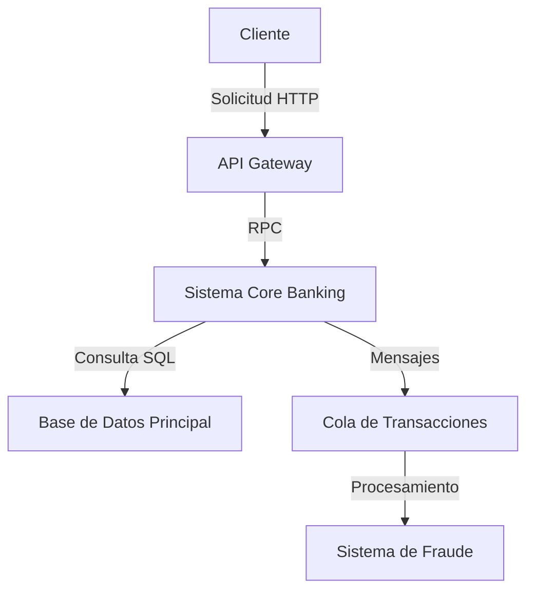
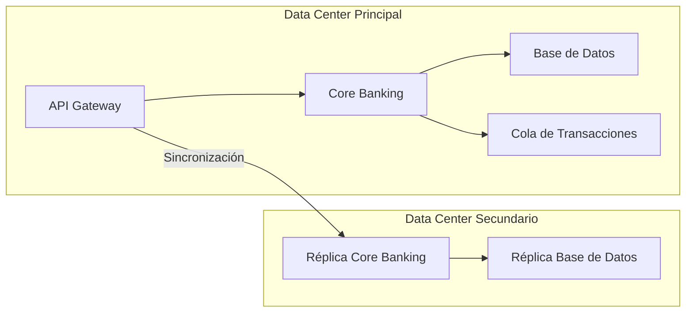

# Arquitectura de Transformación Digital para [Nombre de la Corporación]

## 1. Introducción
Este documento describe la arquitectura actual (as-is) de la corporación y sirve como base para proponer mejoras en el marco de su transformación digital. El enfoque se centra en alinear la tecnología con los objetivos estratégicos del negocio, garantizando escalabilidad, seguridad y eficiencia operativa.

### Preguntas guía para completar las vistas arquitectónicas:
- **Vista de Contexto**: ¿Qué actores externos interactúan con el sistema actual? ¿Cuáles son los flujos de información críticos entre ellos?
- **Vista de Contenedores**: ¿Qué sistemas o servicios componen la arquitectura actual? ¿Cómo se comunican entre sí?
- **Vista de Componentes**: ¿Qué módulos o subsistemas existen dentro de cada contenedor? ¿Cuáles son sus responsabilidades?
- **Vista de Despliegue**: ¿Cómo se distribuyen los contenedores en la infraestructura actual? ¿Qué dependencias existen entre ellos?

---

## 2. Vista de Contexto (as-is)
*Describa aquí los actores externos y los sistemas con los que interactúa la corporación. Incluya flujos de información clave.*

> **Preguntas guía**:
> - ¿Qué sistemas externos (ej. proveedores de servicios financieros, reguladores, clientes) interactúan con la corporación?
> - ¿Cuáles son los protocolos de comunicación utilizados (ej. REST, SOAP, archivos planos)?
> - ¿Existen cuellos de botella o puntos únicos de fallo en los flujos actuales?

---

## 3. Vista de Contenedores (as-is)
*Describa aquí los contenedores principales de la arquitectura actual (ej. sistemas legacy, bases de datos, APIs).*

> **Preguntas guía**:
> - ¿Qué contenedores son críticos para las operaciones diarias?
> - ¿Cómo se gestionan las transacciones entre contenedores (ej. sincrónico vs asíncrono)?
> - ¿Qué tecnologías se utilizan en cada contenedor (ej. Java EE, COBOL, SQL Server)?

---

## 4. Vista de Componentes (as-is)
*Describa aquí los componentes clave dentro de cada contenedor y sus responsabilidades.*

### Sistema Core Banking
- **Componente de Cuentas**: Gestiona aperturas, cierres y consultas de cuentas.
- **Componente de Transacciones**: Procesa transferencias, pagos y depósitos.
- **Componente de Reportes**: Genera reportes regulatorios y analíticos.

### API Gateway
- **Autenticación**: Validación de tokens JWT.
- **Rate Limiting**: Control de tráfico entrante.
- **Transformación de Datos**: Conversión entre formatos (JSON ↔ XML).

> **Preguntas guía**:
> - ¿Qué componentes tienen mayor complejidad técnica o deuda arquitectónica?
> - ¿Cómo se integran los componentes con sistemas externos (ej. SWIFT, Visa)?
> - ¿Existen componentes redundantes o con funcionalidades solapadas?

---

## 5. Vista de Despliegue (as-is)
*Describa aquí cómo se despliegan los contenedores en la infraestructura actual.*

> **Preguntas guía**:
> - ¿Qué dependencias existen entre los nodos de despliegue?
> - ¿Cómo se gestiona la alta disponibilidad y la recuperación ante desastres?
> - ¿Qué limitaciones impone la infraestructura actual (ej. latencia, capacidad)?

---

## 6. Identificación de Brechas y Oportunidades
*Identifique aquí las brechas entre la arquitectura actual y los objetivos de transformación digital.*

> **Preguntas guía**:
> - ¿Qué componentes no escalan para soportar el crecimiento esperado?
> - ¿Qué tecnologías obsoletas requieren modernización?
> - ¿Qué procesos manuales podrían automatizarse con soluciones digitales?

---

## 7. Recomendaciones Iniciales
*Proporcione aquí recomendaciones preliminares para la transformación digital, basadas en los ASRs y las brechas identificadas.*

> **Preguntas guía**:
> - ¿Qué patrones arquitectónicos (ej. microservicios, eventos) podrían resolver las brechas identificadas?
> - ¿Qué tecnologías emergentes (ej. blockchain, IA) podrían agregar valor al negocio?
> - ¿Cómo se priorizarían las inversiones en función del ROI esperado?

---